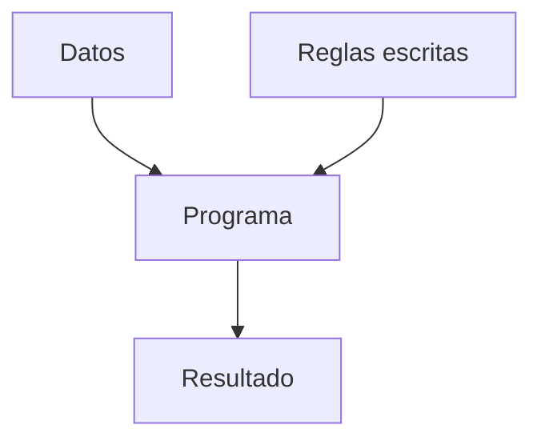
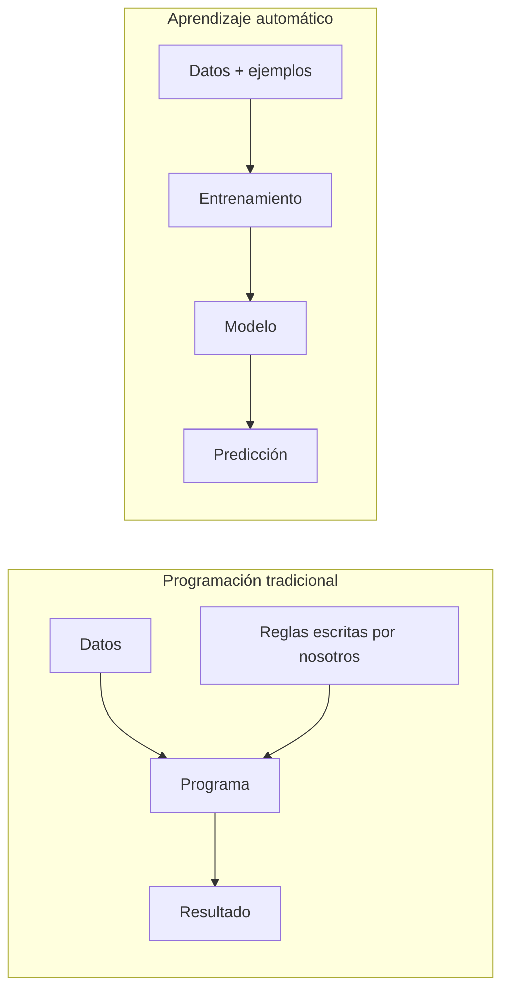
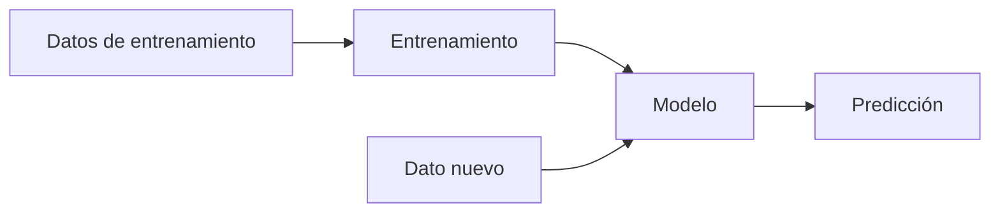
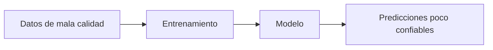
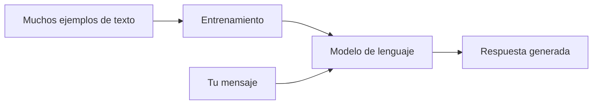
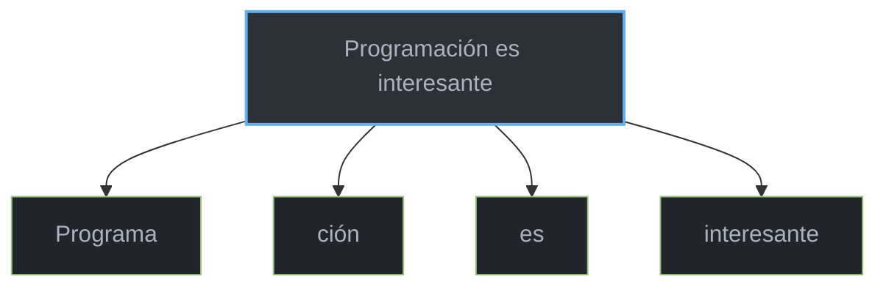
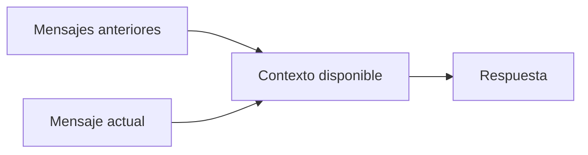
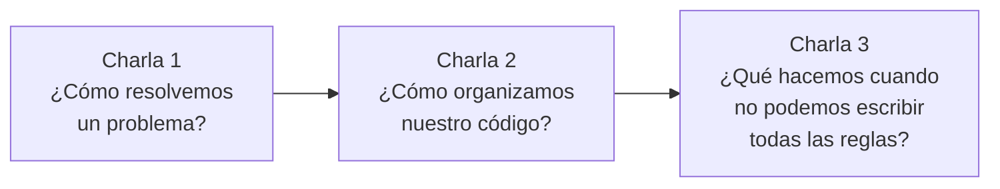

# ¿Cómo aprende una computadora? Inteligencia artificial sin magia

**Charla 3 de 3 · Introducción conceptual a la inteligencia artificial**

## Objetivo de la charla

Al terminar, la idea principal es comprender que:

> “La inteligencia artificial no es magia. Algunos sistemas aprenden patrones a partir de datos, usan esos patrones para hacer predicciones y pueden equivocarse, por lo que debemos usarlos con criterio.”

---

## 1. ¿Qué cosas realmente usan inteligencia artificial?

> La introducción parte de tecnologías cotidianas que pueden utilizar inteligencia artificial.
>
> Se propone al público identificar cuáles utilizan inteligencia artificial y justificar sus respuestas.

### Actividad inicial: ¿IA o no IA?

Se presentan los siguientes casos:

| Tecnología                 |    ¿Usa IA?    |
| -------------------------- | :------------: |
| ChatGPT                    | Por determinar |
| Calculadora                | Por determinar |
| Recomendaciones de YouTube | Por determinar |
| Filtro de spam del correo  | Por determinar |
| Reconocimiento facial      | Por determinar |
| `if (nota >= 61)`          | Por determinar |
| Autocorrector              | Por determinar |
| NPC de un videojuego       | Por determinar |

> ¿Cuáles de estas tecnologías creen que utilizan inteligencia artificial?

La clasificación se discute antes de presentar conclusiones.

Algunos ejemplos son bastante claros:

- Una calculadora tradicional no necesita aprender patrones.
- Un `if` ejecuta reglas que un programador escribió explícitamente.
- Un sistema de recomendaciones puede utilizar modelos que buscan patrones en los datos.
- Un filtro de spam puede aprender características comunes de mensajes no deseados.
- Un sistema de reconocimiento facial puede utilizar modelos entrenados con imágenes.

Otros casos pueden depender de cómo esté construido el sistema.

Por ejemplo, un autocorrector o un NPC de videojuego podría utilizar reglas tradicionales, inteligencia artificial o una combinación de ambos.

> Usamos la palabra “inteligencia artificial” para muchas cosas diferentes.
>
> Por eso, antes de memorizar una definición, primero vamos a entender qué problema intenta resolver.

### Primera idea

> **No todo programa es inteligencia artificial.**

Un programa puede funcionar perfectamente utilizando únicamente reglas escritas por una persona.

Y eso conecta directamente con lo que ya hemos visto en las charlas anteriores.

---

## 2. Hasta ahora nosotros escribíamos las reglas

En las charlas anteriores se trabajó con programas donde las reglas se definían explícitamente.

Por ejemplo:

```java
if (nota >= 61) {
    System.out.println("Aprobado");
} else {
    System.out.println("Reprobado");
}
```

> ¿Quién decidió que una nota mayor o igual a 61 significa “Aprobado”?

El programador.

El programa no descubrió esa regla.

La regla fue escrita explícitamente por el programador.

### Programación tradicional

Podemos imaginarla así:



Ejemplo:

```text
Dato: nota = 75

Regla:
si nota >= 61
    entonces Aprobado

Resultado:
Aprobado
```

> En este tipo de programa nosotros conocemos la regla y se la indicamos directamente a la computadora.
>
> La computadora simplemente ejecuta las instrucciones que escribimos.

### Otro ejemplo

Supongamos que queremos determinar si una persona puede entrar a una actividad:

```java
if (edad >= 18) {
    System.out.println("Puede entrar");
} else {
    System.out.println("No puede entrar");
}
```

La computadora no necesita aprender qué significa ser mayor de edad.

El programador ya le proporcionó la regla.

### La pregunta importante

> ¿Podemos resolver todos los problemas escribiendo reglas de esta manera?

En muchos problemas sí.

Pero hay otros donde escribir manualmente todas las reglas posibles puede volverse extremadamente difícil.

Y ahí aparece el siguiente problema.

---

### Idea principal

> **Hay problemas donde es muy difícil escribir manualmente todas las reglas.**

Y entonces podemos hacernos otra pregunta:

> **¿Y si en vez de darle todas las reglas a la computadora, le damos muchos ejemplos?**

---

## 3. Aprender a partir de ejemplos

Para abordar esta dificultad se introduce una idea importante de la inteligencia artificial moderna:

### Aprendizaje automático

El **aprendizaje automático** o *machine learning* busca construir sistemas capaces de encontrar patrones a partir de datos.

En lugar de escribir todas las reglas manualmente, podemos mostrar ejemplos.

Por ejemplo:

| Tiene pelo | Ladra | Maúlla | Resultado |
| ---------- | ----- | ------ | --------- |
| Sí         | Sí    | No     | Perro     |
| Sí         | No    | Sí     | Gato      |
| Sí         | Sí    | No     | Perro     |
| Sí         | No    | Sí     | Gato      |

Después presentamos un caso nuevo:

| Tiene pelo | Ladra | Maúlla | ¿Qué es?       |
| ---------- | ----- | ------ | -------------- |
| Sí         | No    | Sí     | Por determinar |

> ¿Qué creen que es?

Respuesta esperada:

> Gato.

Una pregunta permite observar cómo se reconoce el patrón:

> ¿En algún momento escribimos una regla que dijera `if maulla == true then gato`?

No.

Al observar los ejemplos se puede encontrar un patrón.

Eso nos da una intuición de lo que intentamos conseguir con el aprendizaje automático.

### Programación tradicional vs. aprendizaje automático



### Cuatro palabras importantes

#### Datos

Son los ejemplos o información que utilizamos.

```text
Perro
Perro
Gato
Perro
Gato
...
```

#### Entrenamiento

Es el proceso mediante el cual el sistema ajusta un modelo intentando encontrar patrones en esos datos.

#### Modelo

Es el resultado del proceso de entrenamiento.

Puede entenderse como una estructura matemática capaz de utilizar los patrones aprendidos.

#### Predicción

Es la respuesta que produce el modelo cuando recibe información nueva.



> Lo importante no es memorizar términos aislados.
>
> La idea que debe recordarse es:
>
> **muchos ejemplos → encontrar patrones → utilizar esos patrones con casos nuevos.**

> [!NOTE]
> No todos los sistemas de inteligencia artificial funcionan exactamente de esta manera. Para esta charla estamos utilizando el aprendizaje automático como una forma sencilla de comprender gran parte de la IA moderna.

---

## 4. Actividad: ustedes son el modelo

La actividad propone encontrar patrones a partir de ejemplos.

Supongamos que tenemos estos datos de estudiantes:

| Horas de estudio | Asistencia | ¿Aprobó? |
| :--------------: | :--------: | :------: |
|        5         |    95%     |    Sí    |
|        1         |    40%     |    No    |
|        6         |    90%     |    Sí    |
|        2         |    50%     |    No    |
|        7         |    85%     |    Sí    |

A continuación se presenta un caso nuevo:

| Horas de estudio | Asistencia | ¿Qué creen?    |
| :--------------: | :--------: | -------------- |
|        6         |    92%     | Por determinar |

> Utilizando solamente los ejemplos anteriores, ¿qué resultado predecirían?

Una predicción razonable sería:

> Aprobó.

Después se presenta un caso menos evidente:

| Horas de estudio | Asistencia | ¿Qué creen?    |
| :--------------: | :--------: | -------------- |
|        8         |    20%     | Por determinar |

> ¿Y ahora qué predecirían?

En este caso pueden surgir respuestas distintas.

Esto permite comparar diferentes interpretaciones de los mismos datos.

### No todos los casos son obvios

Los datos pueden ser:

- incompletos;
- ambiguos;
- insuficientes;
- contradictorios.

Un modelo también puede enfrentarse a situaciones donde la respuesta no sea evidente.

> Un modelo no recibe una lista mágica de respuestas correctas.
>
> Intenta utilizar los patrones que aprendió para producir una predicción.

### Una observación importante

Si los ejemplos que utilizamos para aprender son malos, insuficientes o poco representativos, el resultado también puede ser malo.



> La calidad de los datos importa.

---

## 5. Entonces… ¿dónde entra ChatGPT?

Hasta ahora se han presentado modelos capaces de identificar patrones en distintos tipos de datos.

El siguiente paso consiste en considerar un tipo particular de información:

> **el lenguaje.**

### Actividad: completar frases

> Completen esta frase:
>
> “El cielo normalmente es de color…”

Respuesta probable:

> Azul.

Otra:

> “Después de estudiar toda la noche estaba muy…”

Posibles respuestas:

- cansado;
- agotado;
- dormido.

Ahora algo más abierto:

> “Había una vez un…”

Podemos obtener muchísimas continuaciones:

- niño;
- rey;
- dragón;
- perro;
- pueblo;
- científico.

### ¿Cómo sabemos qué palabras podrían seguir?

Porque nosotros hemos visto y utilizado lenguaje durante años.

Conocemos patrones.

Sabemos que:

```text
"El cielo es de color..."
```

probablemente será seguido por algo como:

```text
azul
gris
naranja
```

y no normalmente por:

```text
computadora
lunes
zapato
```

### Modelo de lenguaje

Un **modelo de lenguaje** aprende patrones acerca de cómo se utiliza el lenguaje.

> Durante el entrenamiento, un modelo de lenguaje procesa enormes cantidades de ejemplos de texto y ajusta sus parámetros para aprender relaciones y patrones.
>
> Cuando recibe una conversación, utiliza lo que aprendió y el contexto disponible para generar una continuación que tenga sentido.

### Una forma sencilla de visualizarlo



### ¿ChatGPT tiene una lista con todas las respuestas?

No.

No funciona como:

```text
Pregunta 1 → Respuesta 1
Pregunta 2 → Respuesta 2
Pregunta 3 → Respuesta 3
```

Genera una respuesta progresivamente utilizando patrones aprendidos y el contexto disponible.

> [!NOTE]
> Decir únicamente que “ChatGPT predice la siguiente palabra” puede ser demasiado simplificado. Una manera más útil de entenderlo es que genera texto paso a paso, estimando continuaciones posibles según patrones aprendidos y el contexto.

---

## 6. Tokens: pequeñas unidades de texto

Cuando nosotros leemos:

```text
Programación es interesante
```

vemos palabras completas.

Un modelo de lenguaje procesa el texto mediante unidades llamadas **tokens**.

### ¿Qué es un token?

Para esta charla podemos entenderlo como:

> **Una pequeña unidad de texto que el modelo procesa.**

Una palabra puede ser un token, varios tokens o incluso compartir partes con otras palabras.

Ejemplo ilustrativo:



> [!NOTE]
> Esta separación es solamente un ejemplo visual. La división real depende del modelo y del tokenizador utilizado.

### ¿Por qué existen?

Porque el modelo necesita convertir el texto en unidades que pueda procesar matemáticamente.

En esta charla no es necesario profundizar en los mecanismos matemáticos de tokenización.

#### Idea principal

> **Los modelos de lenguaje no necesariamente procesan nuestro texto como palabras completas; trabajan con unidades llamadas tokens.**

---

## 7. El contexto: ¿de qué estamos hablando?

Para ilustrar el contexto, se realiza una breve actividad.

> “Mi perro se llama Firulais.”

Después se conversa brevemente sobre otro tema.

Más adelante se plantea la pregunta:

> ¿Cómo se llama mi perro?

Respuesta:

> Firulais.

¿Por qué podemos responder?

Porque recordamos información que apareció anteriormente en la conversación.

### El contexto

Un modelo de lenguaje también utiliza información previa de la interacción para interpretar nuevos mensajes.

Por ejemplo:

```text
Usuario:
Tengo dos perros. Uno se llama Firulais y el otro Max.

Usuario:
¿Cuál de los dos empieza con F?
```

La segunda pregunta requiere la información del mensaje anterior.

### Ventana de contexto

Los modelos tienen una cantidad limitada de información que pueden tener disponible durante una interacción.

A esto se le suele llamar:

> **Ventana de contexto**

Podemos imaginarla como una especie de espacio de trabajo temporal.



> El contexto ayuda al modelo a entender de qué estamos hablando.
>
> Pero ese espacio no es necesariamente infinito.

#### Idea principal

> **Contexto = información disponible que ayuda al modelo a interpretar la conversación.**

---

## 8. La trampa: sonar convincente no significa tener razón

Una de las ideas fundamentales de la charla es distinguir entre una respuesta convincente y una respuesta correcta.

> Si una inteligencia artificial responde con muchísima seguridad, ¿significa que la respuesta es correcta?

No necesariamente.

### Una analogía

Imaginen que están haciendo un examen.

No recuerdan la respuesta.

Pero en lugar de escribir:

> “No sé.”

escriben tres párrafos que:

- suenan académicos;
- utilizan palabras complicadas;
- parecen muy seguros.

¿Eso hace que la respuesta sea correcta?

No.

### Alucinaciones

En los modelos de lenguaje se utiliza frecuentemente la palabra **alucinación** para describir situaciones donde el modelo genera información incorrecta, inexistente o no respaldada como si fuera una respuesta válida.

Ejemplos posibles:

- inventar el nombre de un libro;
- atribuir una frase a una persona que nunca la dijo;
- proporcionar una fecha incorrecta;
- afirmar que existe una función de programación que en realidad no existe;
- citar una fuente inexistente.

### Frase importante

> **Una respuesta plausible no es necesariamente una respuesta verdadera.**

### ¿Por qué puede ocurrir?

Para esta introducción basta con comprender que:

- el modelo genera respuestas a partir de patrones;
- puede tener información insuficiente;
- puede interpretar mal el contexto;
- puede producir una continuación que suene razonable pero sea incorrecta.

> [!NOTE]
> No necesitamos estudiar aquí todos los detalles técnicos de por qué ocurren las alucinaciones. Lo importante es comprender que pueden ocurrir.

---

## 9. ¿Cómo puede ayudarme la IA como estudiante?

Además de examinar los posibles errores, conviene reconocer los usos educativos de la inteligencia artificial.

Una IA puede servir como herramienta para:

- pedir que un concepto sea explicado de otra forma;
- generar ejemplos;
- practicar preguntas;
- crear ejercicios similares;
- analizar errores de código;
- comparar soluciones;
- recibir retroalimentación;
- organizar ideas;
- resumir información que ya tenemos;
- practicar antes de una evaluación.

### Dos formas diferentes de utilizarla

#### Uso A

> “Hazme la tarea.”

#### Uso B

> “Explícame por qué mi procedimiento está mal y dame otro ejercicio parecido para intentarlo.”

> ¿Cuál de las dos opciones ayuda más a aprender?

La segunda.

### Una diferencia importante

> **Usar IA para aprender no es lo mismo que usar IA para evitar aprender.**

La herramienta puede producir una respuesta, pero comprenderla sigue siendo responsabilidad de quien la utiliza.

---

## 10. Si la IA puede programar, ¿para qué aprender programación?

La charla concluye con una pregunta abierta:

> Si una inteligencia artificial puede generar código, ¿todavía vale la pena aprender a programar?

Se abre un espacio para escuchar primero las opiniones de los estudiantes.

Pueden aparecer ideas como:

- sí, porque debemos entender el código;
- sí, porque la IA puede equivocarse;
- quizá cambie la forma de programar;
- tal vez algunas tareas se automaticen;
- necesitamos saber qué pedir;
- debemos revisar lo que genera.

### Volvamos a la primera charla

En la primera charla se explicó que programar no consiste únicamente en escribir líneas de código.

Programar implica:

- comprender un problema;
- dividirlo en partes;
- diseñar una solución;
- decidir qué información necesitamos;
- verificar resultados;
- corregir errores.

Una inteligencia artificial puede ayudarnos en varias de esas tareas.

Pero no elimina la necesidad de pensar.

### Las tres charlas juntas



### Cierre

> La inteligencia artificial cambia las herramientas que tenemos disponibles, pero no elimina la necesidad de comprender los problemas.
>
> Cuanto más poderosa sea una herramienta, más importante es saber cuándo utilizarla, cómo evaluar sus resultados y cuándo desconfiar de ellos.

#### Ideas que quiero que recuerden

1. No todo programa es inteligencia artificial.
2. En la programación tradicional solemos escribir las reglas.
3. Algunos sistemas de IA aprenden patrones a partir de datos.
4. Un modelo utiliza esos patrones para producir predicciones.
5. Los modelos de lenguaje aprenden patrones del lenguaje.
6. Los LLM procesan texto mediante tokens y utilizan contexto.
7. Una IA puede equivocarse aunque su respuesta parezca convincente.
8. La IA es una herramienta; utilizarla bien también requiere criterio.

---

## Preguntas de cierre

Al finalizar la charla se preparó un Kahoot de diez preguntas para repasar los conceptos centrales.

|  No.  | Pregunta                                                                              | Opciones                                                                                                                                                                        | Respuesta correcta | Concepto                       |
| :---: | ------------------------------------------------------------------------------------- | ------------------------------------------------------------------------------------------------------------------------------------------------------------------------------- | :----------------: | ------------------------------ |
|   1   | En programación tradicional, ¿quién suele definir las reglas que sigue el programa?   | A) El usuario al azar <br> B) El programador <br> C) La computadora las descubre siempre <br> D) Internet                                                                       |         B          | Reglas explícitas              |
|   2   | ¿Por qué puede ser difícil reconocer un perro escribiendo únicamente reglas manuales? | A) Porque los perros no existen <br> B) Porque una imagen puede tener muchas variaciones <br> C) Porque Java no permite imágenes <br> D) Porque siempre falta Internet          |         B          | Límites de las reglas manuales |
|   3   | ¿Qué describe mejor el aprendizaje automático?                                        | A) Memorizar únicamente respuestas <br> B) Encontrar patrones a partir de datos y ejemplos <br> C) Ejecutar solamente condiciones `if` <br> D) Copiar programas de Internet     |         B          | Aprendizaje automático         |
|   4   | ¿Qué es un modelo, de forma sencilla?                                                 | A) Un sistema entrenado que utiliza patrones aprendidos <br> B) Una computadora más grande <br> C) Un archivo de Word <br> D) Una contraseña                                    |         A          | Modelo                         |
|   5   | Un modelo recibe un caso nuevo y produce una respuesta. ¿Cómo la llamamos?            | A) Herencia <br> B) Constructor <br> C) Predicción <br> D) Variable privada                                                                                                     |         C          | Predicción                     |
|   6   | ¿Qué aprende principalmente un modelo de lenguaje?                                    | A) Patrones del lenguaje <br> B) Solo operaciones matemáticas <br> C) Una lista de todas las respuestas posibles <br> D) Únicamente nombres de personas                         |         A          | Modelos de lenguaje            |
|   7   | ¿Qué es un token?                                                                     | A) Una pequeña unidad de texto que procesa el modelo <br> B) Una contraseña secreta <br> C) Una computadora <br> D) Un error de programación                                    |         A          | Tokens                         |
|   8   | ¿Para qué sirve el contexto en una conversación con un modelo de lenguaje?            | A) Para cambiar el color de la pantalla <br> B) Para interpretar de qué estamos hablando <br> C) Para aumentar la velocidad de Internet <br> D) Para eliminar todos los errores |         B          | Contexto                       |
|   9   | Si una IA responde con mucha seguridad, ¿significa que siempre tiene razón?           | A) Sí, siempre <br> B) Solo si escribe mucho <br> C) No, puede generar información incorrecta <br> D) Sí, si usa palabras complicadas                                           |         C          | Alucinaciones                  |
|  10   | ¿Cuál es una buena forma de utilizar IA para aprender?                                | A) Copiar respuestas sin leer <br> B) Usarla para evitar estudiar <br> C) Pedir explicaciones, practicar y verificar resultados <br> D) Creer todo lo que responda              |         C          | Uso responsable                |